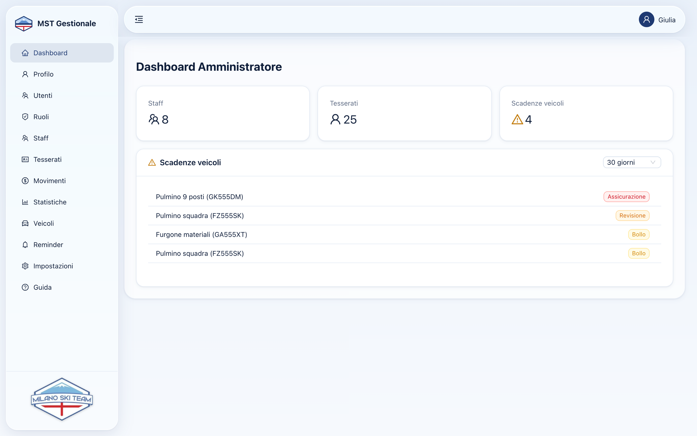
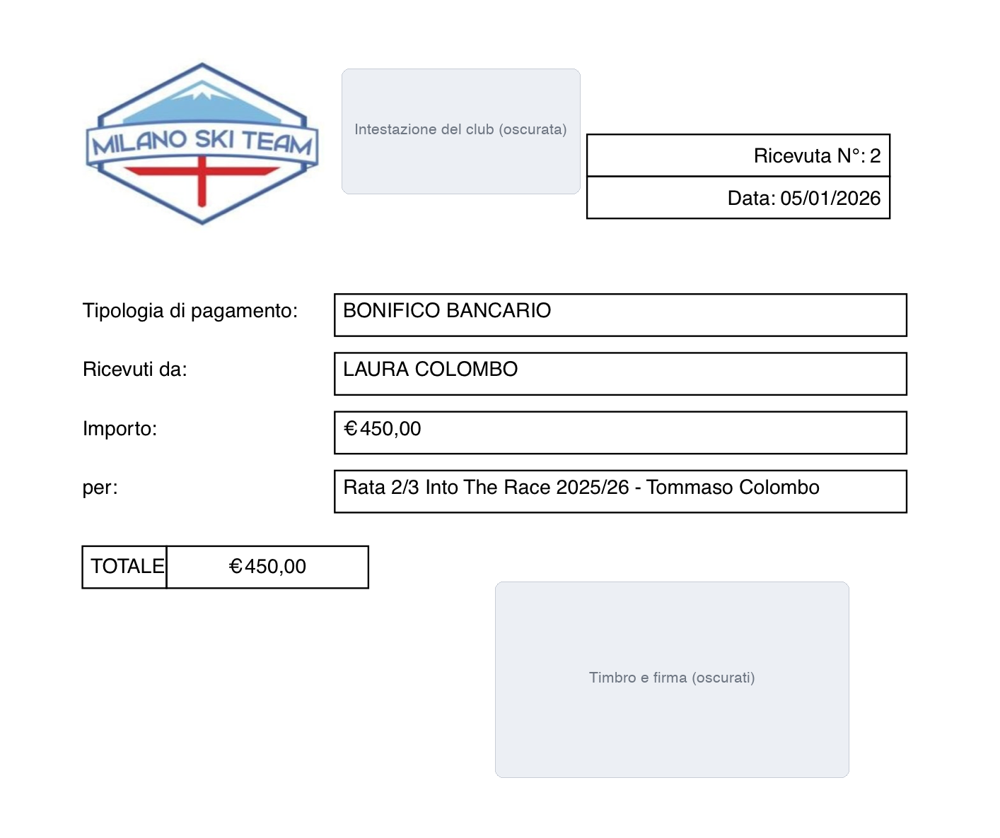
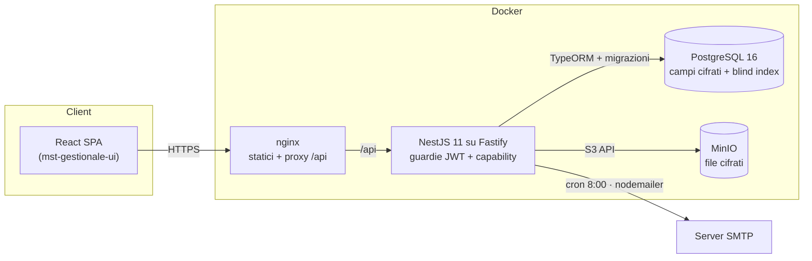

<div align="center">

# MST Gestionale — Backend

**API REST del gestionale di una società sportiva dilettantistica (sci club):** anagrafiche di atleti e staff,
prima nota con ricevute fiscali in PDF, parco mezzi, scadenzario con promemoria via email, backup e ripristino.


Interfaccia web: [`mst-gestionale-ui`](https://github.com/davideorsini94/mst-gestionale-ui) · Versione **1.4**

</div>

---

## Il progetto

MST Gestionale è il software con cui la segreteria di uno sci club milanese gestisce la vita della società: chi è
tesserato e con quale visita medica, quali allenatori hanno patentini in scadenza, quali pulmini devono fare la
revisione, quanto è entrato e uscito nell'anno e con quali ricevute.

È in uso nella segreteria del club e gestisce oltre **11.000 movimenti contabili** e **7.000 documenti**
(ricevute, certificati, foto). Questo repository
contiene il backend: un'API REST in NestJS su Fastify, con PostgreSQL per i dati e MinIO (compatibile S3) per i
file. L'interfaccia React è nel repository [`mst-gestionale-ui`](https://github.com/davideorsini94/mst-gestionale-ui).

<p align="center">
  
  
</p>
<p align="center"><sub>Dati di esempio inventati.</sub></p>

## Punti salienti

### Dati personali cifrati, ma ancora cercabili
- **Cifratura a livello di campo** (AES-256-GCM, formato versionato `enc:v1:`) per nomi, codici fiscali, contatti,
  note e soggetti dei movimenti, tramite un `ValueTransformer` TypeORM: il codice applicativo lavora in chiaro, il
  database vede solo testo cifrato.
- **Blind index HMAC-SHA256** (`emailHash`, `fiscalCodeHash`, `subjectHash`) per ricerche esatte e vincoli di
  unicità senza decifrare.
- **Query pianificate sui campi cifrati**: i filtri e gli ordinamenti richiesti su colonne cifrate vengono separati
  da quelli in chiaro; il DB filtra quello che può, il resto viene decifrato, filtrato e paginato in memoria
  (`src/common/base-crud/encrypted-query.ts`).
- **File cifrati su MinIO** con nomi opachi (`ricevute/AAAA/<uuid>.pdf`): nessun dato personale nei percorsi.
- **Controllo delle chiavi prima delle migrazioni**: con chiavi sbagliate l'app rifiuta di partire senza toccare
  nulla, invece di cifrare con la chiave sbagliata.
- **Migrazione dei dati esistenti** (v1.3 → v1.4) idempotente e riprendibile: cifratura del DB in transazione,
  migrazione dei file con verifica SHA-256 di ogni copia prima di cancellare l'originale.

### Ricevute numerate come richiede la legge
- Numerazione progressiva per anno con `pg_advisory_xact_lock`: nessun doppione nemmeno con richieste concorrenti.
- **Un numero emesso non cambia e non si riusa**: eliminare un'entrata, trasformarla in uscita o spostarla di anno
  annulla la ricevuta e la archivia (con il PDF originale) in `annulled_receipts`.
- PDF generati con `pdfkit` (importi all'italiana, `€ 1.234,56`), rigenerati con lo stesso numero quando cambiano i
  dati stampati.

### Import Excel/CSV robusto
- Riconoscimento dei nomi di colonna (sinonimi, maiuscole, accenti), intestazione cercata tra le prime righe.
- **Separatore decimale dedotto per colonna**, date italiane ed Excel (anche sistema 1904), CSV in UTF-8, UTF-16 e
  windows-1252.
- **Re-import idempotente**: le righe già presenti vengono riconosciute e aggiornate, non duplicate; le nuove sono
  create in ordine di data, così le ricevute risultano in ordine cronologico.
- Strumenti di **manutenzione dati** per sanare gli import storici: archivio e ripristino dei duplicati, revisione
  guidata degli importi salvati ×1000 con livello di confidenza, applicazione in blocco e annullamento.

### Sicurezza
- **RBAC a capability** (19 permessi) con guardie globali: ogni rotta è protetta salvo quelle `@Public()`.
- **Anti-escalation**: senza `CAN_MANAGE_CAPABILITIES` non si assegnano ruoli con permessi che non si possiedono;
  l'ultimo amministratore attivo non si può rimuovere.
- **JWT invalidati** quando l'utente viene disattivato o cambia password; token solo nell'header (download dei
  backup con biglietti monouso da 60 secondi).
- **Recupero password** con token monouso salvati come hash, scadenza di 30 minuti, cooldown e rate limit; nessuna
  enumerazione degli utenti.
- Rate limit sul login, upload anonimi scartati prima di leggerli, rifiuto di HTML/SVG/script, file serviti con
  `Content-Security-Policy: sandbox`, header di sicurezza, Swagger e CORS spenti in produzione.
- **Filtro globale degli errori**: gli errori del database e di Fastify diventano risposte 4xx con messaggi in
  italiano; SQL e stack restano nei log, senza dati personali.

### Backup e ripristino affidabili
- Backup del database (`pg_dump`), dei file (tar del bucket) o completo, scaricabili dall'interfaccia.
- **Ripristino in streaming su disco** (backup da GB senza saturare la RAM), verifica che il backup sia leggibile con
  le chiavi dell'installazione, **backup di sicurezza automatico** e ritorno allo stato precedente se qualcosa fallisce.

### Scadenzario e promemoria
- Job giornaliero (`@nestjs/schedule`) che programma e invia le email di promemoria per visite mediche, patenti,
  patentini, bollo, revisione e assicurazione, con anticipo configurabile per tipo.
- Destinatari e copie per tipo (persona, staff assegnato al mezzo, amministratore), SMTP configurabile a runtime con
  password cifrata, invio di prova, stato e reinvio di ogni promemoria.

## Architettura



```
src/
├── common/
│   ├── auth/            JWT, login, recupero password, guardie e decoratori di permesso
│   ├── base-crud/       servizio CRUD generico, filtri e query sui campi cifrati
│   ├── crypto/          cifratura dei campi e dei file, blind index
│   ├── files/           upload (anche in streaming su disco), tipi consentiti
│   ├── filters/         mappatura degli errori DB/Fastify in risposte 4xx
│   ├── models/          utenti, ruoli, capability
│   └── validators/      date di calendario, codice fiscale, messaggi in italiano
├── migrations/          schema e migrazioni dei dati (cifratura, categorie, ricevute annullate…)
├── minio/               client e migrazione dei file
└── project-related/     tesserati, staff, veicoli, movimenti e ricevute, statistiche,
                         promemoria, impostazioni e backup, dashboard
```

## Stack

| Area | Tecnologie |
|---|---|
| Runtime | Node.js 22, TypeScript |
| Framework | NestJS 11 su Fastify 5, `class-validator`, Swagger/OpenAPI |
| Dati | PostgreSQL 16, TypeORM 0.3 con migrazioni versionate e controllo dello schema all'avvio |
| File | MinIO (API S3) |
| Sicurezza | `@nestjs/jwt`, Passport, bcrypt, `@fastify/rate-limit`, AES-256-GCM e HMAC con `node:crypto` |
| Documenti | `pdfkit` (ricevute), `xlsx` (import) |
| Email e job | `nodemailer`, `@nestjs/schedule` |
| Log | `winston` con rotazione giornaliera |
| Test | Jest (188 test: cifratura, query cifrate, migrazione dei file, import, importi, validatori, errori) |

## Avvio in locale

Requisiti: Node.js 22, Docker (per PostgreSQL e MinIO) e `pg_dump`/`pg_restore` 16 se vuoi provare i backup.

```bash
# 1. database e storage
docker run -d --name mst-pg -p 127.0.0.1:5432:5432 \
  -e POSTGRES_PASSWORD=postgres -e POSTGRES_DB=mst_gestionale postgres:16
docker run -d --name mst-minio -p 127.0.0.1:9000:9000 \
  -e MINIO_ROOT_USER=minio -e MINIO_ROOT_PASSWORD=minio-local-123 quay.io/minio/minio server /data

# 2. configurazione: copia l'esempio e genera chiavi nuove
cp .env.example .env
openssl rand -base64 48   # → JWT_SECRET
openssl rand -base64 32   # → DATA_ENCRYPTION_KEY
openssl rand -base64 32   # → DATA_HASH_KEY (diversa dalla precedente)

# 3. avvio: al primo avvio le migrazioni creano lo schema e il seed crea i ruoli admin, staff e user
npm install
npm run start:dev
```

L'API risponde su `http://localhost:3000/api` e in sviluppo la documentazione Swagger è su `/api`.
Il primo utente amministratore si crea direttamente nel database (password con bcrypt), poi gli altri dall'interfaccia.

> **Le chiavi di cifratura non si cambiano dopo il primo avvio**: senza le chiavi originali dati, file e backup non
> sono più leggibili. Conservale fuori dal server.

### Comandi

```bash
npm run start:dev   # sviluppo con ricarica automatica
npm run build       # compilazione in dist/
npm test            # test Jest
npm run lint        # ESLint
```

### Configurazione principale

| Variabile | Descrizione |
|---|---|
| `APP_PORT`, `APP_PUBLIC_URL` | porta dell'API e indirizzo pubblico dell'app (link nelle email) |
| `DB_HOST`, `DB_PORT`, `DB_USERNAME`, `DB_PASSWORD`, `DB_DATABASE` | connessione PostgreSQL |
| `JWT_SECRET`, `TOKEN_DURATION` | firma e durata delle sessioni (predefinita 8h) |
| `DATA_ENCRYPTION_KEY`, `DATA_HASH_KEY` | chiavi di cifratura e dei blind index (32 byte in base64) |
| `MINIO_HOST`, `MINIO_PORT`, `MINIO_ACCESS_KEY`, `MINIO_SECRET_KEY`, `MINIO_BUCKET` | storage dei file |
| `BACKUP_DIR`, `PG_BIN_DIR` | cartella dei backup e di `pg_dump` |
| `REMINDER_ENABLED`, `REMINDER_DAYS_*` | promemoria automatici e giorni di anticipo per tipo |
| `SWAGGER_ENABLED`, `CORS_ORIGIN` | in produzione spenti salvo valore esplicito |

L'elenco completo e commentato è in [`.env.example`](.env.example).

## Docker

Il `Dockerfile` è a due fasi: compila con le dipendenze di sviluppo, poi copia in un'immagine Ubuntu 24.04 solo il
runtime Node.js 22, `dist/`, le dipendenze di produzione e il client PostgreSQL 16 per i backup (immagine da circa
540 MB, contro i 3 GB della versione precedente).

```bash
docker build -t mst-gestionale-be .
docker run --env-file .env -e BACKUP_DIR=/backups -v mst-backups:/backups -p 3000:3000 mst-gestionale-be
```

In produzione gira dietro nginx (che serve l'interfaccia e fa da proxy per `/api`) con PostgreSQL e MinIO
distribuito su container separati.

## Autore

Progettato e sviluppato da **Davide Orsini** per Milano Ski Team.
